# Architecture

Generated by `node scripts/catalog.mjs` (do not edit). Built from each `component.json` `needs` only, not from actual imports (`npm run check` fails an import that escapes a component folder). Components have no layer field. An arrow `a --> b` means a needs b. Details: [CATALOG.md](CATALOG.md).

```mermaid
graph LR
  achievements["achievements"] --> play_stats["play-stats"]
  app_frame["app-frame"] --> state_machines["state-machines"]
  app_icons["app-icons"]
  art_pipeline["art-pipeline"] --> tooling_scripts["tooling-scripts"]
  audio_gen["audio-gen"]
  automa["automa"] --> engine_core["engine-core"]
  automa["automa"] --> sim_pool["sim-pool"]
  board_layout["board-layout"]
  board_model["board-model"]
  board_registry["board-registry"]
  board_viewport["board-viewport"]
  boundary_check["boundary-check"]
  bug_reporter["bug-reporter"] --> state_machines["state-machines"]
  bug_reporter["bug-reporter"] --> small_helpers["small-helpers"]
  bundle_size["bundle-size"]
  campaign["campaign"]
  card_attachments["card-attachments"] --> scan_ingest["scan-ingest"]
  card_hand["card-hand"] --> engine_core["engine-core"]
  card_hand["card-hand"] --> card_zones["card-zones"]
  card_hand["card-hand"] --> drag_drop["drag-drop"]
  card_hand["card-hand"] --> motion_frame["motion-frame"]
  card_hand["card-hand"] --> picked_state["picked-state"]
  card_hand["card-hand"] --> prompt_host["prompt-host"]
  card_harness["card-harness"] --> engine_core["engine-core"]
  card_harness["card-harness"] --> plain_text["plain-text"]
  card_language["card-language"] --> engine_core["engine-core"]
  card_language["card-language"] --> card_harness["card-harness"]
  card_language["card-language"] --> plain_text["plain-text"]
  card_language["card-language"] --> card_zones["card-zones"]
  card_parts["card-parts"]
  card_patches["card-patches"]
  card_pile["card-pile"] --> card_zones["card-zones"]
  card_pile["card-pile"] --> prompt_host["prompt-host"]
  card_pile["card-pile"] --> picked_state["picked-state"]
  card_pile["card-pile"] --> phone_mode["phone-mode"]
  card_pile["card-pile"] --> motion_frame["motion-frame"]
  card_query["card-query"]
  card_zones["card-zones"] --> engine_core["engine-core"]
  card_zoom["card-zoom"] --> card_parts["card-parts"]
  card_zoom["card-zoom"] --> glossary["glossary"]
  card_zoom["card-zoom"] --> plain_text["plain-text"]
  challenges["challenges"]
  character_select["character-select"]
  check_runner["check-runner"]
  ci_templates["ci-templates"]
  clock["clock"]
  content_pack["content-pack"] --> card_harness["card-harness"]
  content_pack["content-pack"] --> card_language["card-language"]
  content_pack["content-pack"] --> card_parts["card-parts"]
  content_pack["content-pack"] --> engine_core["engine-core"]
  controls["controls"]
  counter["counter"] --> effect_library["effect-library"]
  counter["counter"] --> motion_frame["motion-frame"]
  counter["counter"] --> ui_helpers["ui-helpers"]
  coverage_report["coverage-report"]
  debug_console["debug-console"] --> engine_core["engine-core"]
  deck_motions["deck-motions"] --> motion_frame["motion-frame"]
  dev_autoplay["dev-autoplay"] --> engine_core["engine-core"]
  dev_autoplay["dev-autoplay"] --> game_store["game-store"]
  dev_autoplay["dev-autoplay"] --> sim_pool["sim-pool"]
  dice_odds["dice-odds"]
  dice_patterns["dice-patterns"]
  dice_tray["dice-tray"] --> state_machines["state-machines"]
  drag_drop["drag-drop"] --> prompt_host["prompt-host"]
  drag_drop["drag-drop"] --> motion_frame["motion-frame"]
  drag_drop["drag-drop"] --> engine_core["engine-core"]
  drag_drop["drag-drop"] --> prompt_source["prompt-source"]
  e2e_helpers["e2e-helpers"]
  effect_library["effect-library"] --> motion_frame["motion-frame"]
  effect_library["effect-library"] --> board_registry["board-registry"]
  engine_core["engine-core"]
  game_log["game-log"] --> engine_core["engine-core"]
  game_store["game-store"] --> engine_core["engine-core"]
  game_store["game-store"] --> prompt_host["prompt-host"]
  game_store["game-store"] --> paced_view["paced-view"]
  game_store["game-store"] --> sim_pool["sim-pool"]
  game_store["game-store"] --> replay_cli["replay-cli"]
  ghost_card["ghost-card"]
  glossary["glossary"] --> phone_mode["phone-mode"]
  glossary["glossary"] --> state_machines["state-machines"]
  grid_map["grid-map"]
  guarded_button["guarded-button"]
  layout_editor["layout-editor"] --> board_layout["board-layout"]
  learned_opponent["learned-opponent"] --> engine_core["engine-core"]
  learned_opponent["learned-opponent"] --> sim_pool["sim-pool"]
  lint_preset["lint-preset"]
  llm_playtester["llm-playtester"]
  looked_at["looked-at"] --> card_zoom["card-zoom"]
  market_row["market-row"] --> engine_core["engine-core"]
  market_row["market-row"] --> card_zones["card-zones"]
  market_row["market-row"] --> prompt_host["prompt-host"]
  market_row["market-row"] --> picked_state["picked-state"]
  market_row["market-row"] --> motion_frame["motion-frame"]
  market_row["market-row"] --> deck_motions["deck-motions"]
  modal_dialog["modal-dialog"]
  motion_frame["motion-frame"]
  offline["offline"] --> state_machines["state-machines"]
  opponent["opponent"] --> sim_pool["sim-pool"]
  paced_view["paced-view"]
  perf["perf"] --> engine_core["engine-core"]
  perf["perf"] --> sim_pool["sim-pool"]
  phone_mode["phone-mode"] --> state_machines["state-machines"]
  picked_state["picked-state"]
  picture_upscale["picture-upscale"]
  pieces_3d["pieces-3d"]
  pieces_3d_verbs["pieces-3d-verbs"] --> pieces_3d["pieces-3d"]
  pieces_3d_verbs["pieces-3d-verbs"] --> effect_library["effect-library"]
  pieces_3d_verbs["pieces-3d-verbs"] --> motion_frame["motion-frame"]
  plain_text["plain-text"]
  plan_checker["plan-checker"]
  play_stats["play-stats"]
  player_board["player-board"] --> card_zones["card-zones"]
  player_board["player-board"] --> board_layout["board-layout"]
  player_board["player-board"] --> card_attachments["card-attachments"]
  prompt_gallery["prompt-gallery"]
  prompt_host["prompt-host"] --> engine_core["engine-core"]
  prompt_host["prompt-host"] --> prompt_source["prompt-source"]
  prompt_source["prompt-source"]
  proof_sheet["proof-sheet"]
  reference_game["reference-game"] --> scaffold["scaffold"]
  replay_cli["replay-cli"] --> engine_core["engine-core"]
  replay_cli["replay-cli"] --> sim_pool["sim-pool"]
  repo_gate["repo-gate"]
  resolution_frame["resolution-frame"] --> settings["settings"]
  rules_screen["rules-screen"] --> glossary["glossary"]
  rules_screen["rules-screen"] --> card_parts["card-parts"]
  rules_screen["rules-screen"] --> screens["screens"]
  saves["saves"] --> engine_core["engine-core"]
  saves["saves"] --> small_helpers["small-helpers"]
  scaffold["scaffold"]
  scan_ingest["scan-ingest"]
  screens["screens"]
  settings["settings"]
  sim_pool["sim-pool"] --> engine_core["engine-core"]
  sim_pool["sim-pool"] --> card_harness["card-harness"]
  small_helpers["small-helpers"]
  sound_player["sound-player"]
  state_machines["state-machines"]
  story["story"] --> engine_core["engine-core"]
  table_panels["table-panels"] --> game_log["game-log"]
  table_panels["table-panels"] --> paced_view["paced-view"]
  target_arrow["target-arrow"]
  test_setup["test-setup"]
  theme_check["theme-check"]
  token_bag["token-bag"]
  token_flights["token-flights"]
  tooling_scripts["tooling-scripts"]
  traceability["traceability"]
  track["track"] --> counter["counter"]
  track["track"] --> motion_frame["motion-frame"]
  transcription_check["transcription-check"]
  turn_flow["turn-flow"] --> engine_core["engine-core"]
  tutorial["tutorial"] --> engine_core["engine-core"]
  tutorial["tutorial"] --> state_machines["state-machines"]
  ui_helpers["ui-helpers"]
  voice["voice"] --> sound_player["sound-player"]
  worker_rules["worker-rules"]
```

## Leaf parts nothing needs

- `achievements`
- `app-frame`
- `app-icons`
- `art-pipeline`
- `audio-gen`
- `automa`
- `board-model`
- `board-viewport`
- `boundary-check`
- `bug-reporter`
- `bundle-size`
- `campaign`
- `card-hand`
- `card-patches`
- `card-pile`
- `card-query`
- `challenges`
- `character-select`
- `check-runner`
- `ci-templates`
- `clock`
- `content-pack`
- `controls`
- `coverage-report`
- `debug-console`
- `dev-autoplay`
- `dice-odds`
- `dice-patterns`
- `dice-tray`
- `e2e-helpers`
- `ghost-card`
- `grid-map`
- `guarded-button`
- `layout-editor`
- `learned-opponent`
- `lint-preset`
- `llm-playtester`
- `looked-at`
- `market-row`
- `modal-dialog`
- `offline`
- `opponent`
- `perf`
- `picture-upscale`
- `pieces-3d-verbs`
- `plan-checker`
- `player-board`
- `prompt-gallery`
- `proof-sheet`
- `reference-game`
- `repo-gate`
- `resolution-frame`
- `rules-screen`
- `saves`
- `story`
- `table-panels`
- `target-arrow`
- `test-setup`
- `theme-check`
- `token-bag`
- `token-flights`
- `traceability`
- `track`
- `transcription-check`
- `turn-flow`
- `tutorial`
- `voice`
- `worker-rules`
