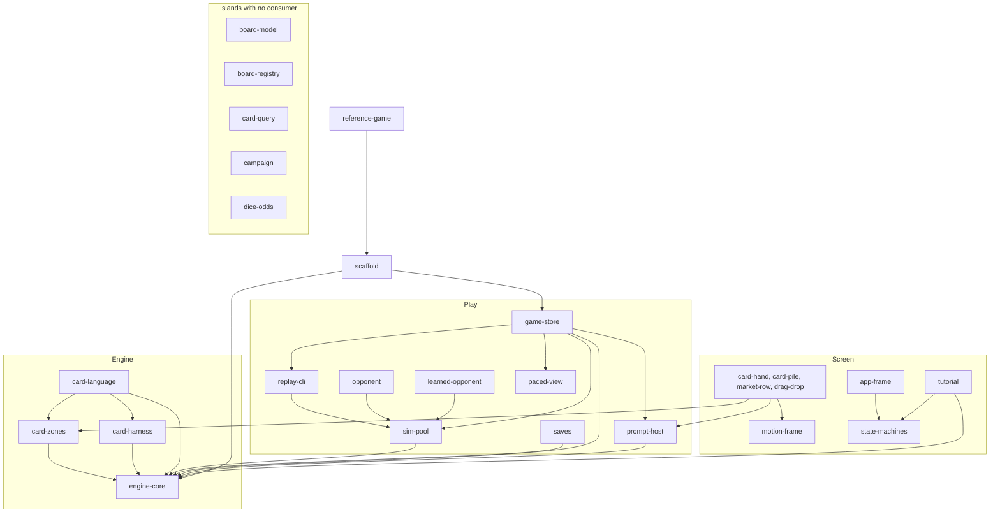
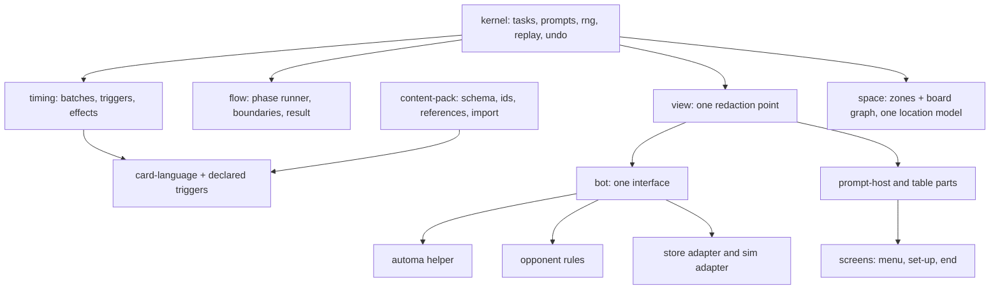

# Game Kit audit: architecture, agent readiness, end-to-end coverage

Repository: `pateta51-ops/game-kit`, `main` at `ea9869a` (tag v0.67.0 exists; `main` docs say v0.66.0). Audit date 16 Nov 2026. Read-only: nothing in the repository was changed.

**How to read the evidence tags.** V = verified by reading code or by an executed run. S = strongly supported. I = inferred. U = unknown. Paths are relative to the repository root unless they start with a drive letter.

**What was executed.**

| Check | Result | Tag |
|---|---|---|
| CI run on `main` head `ea9869a` (self-hosted `kit` runner): lint, typecheck, vitest, components check | all four lanes passed; 226 test files, 1,958 tests, 0 skipped, 19 s | V (run log read with `gh run view`) |
| CI job `pytest scan-ingest` on the same commit | success, but the job skips pytest when `components/scan-ingest` is unchanged, so this run proves nothing about the Python suite | V |
| Last 100 CI runs | 80 success, 3 failure, 17 cancelled | V |
| Local `npm run typecheck` on the Windows checkout | failed: `three` not found. The local `node_modules` is older than the lock file (three was added today). Environment problem, not a repository defect | V |
| Local `components:check` | 80 components ok, catalogue ok; README example compile failed for the same `three` reason | V |
| Branch protection query | GitHub returns 403: not available on this plan for a private repository | V |
| Full test suite locally, `kit.mjs new`, `pull`, `finish`, game-server | not run (owner rule: tests run on the runner; the others have side effects) | - |

Four inspectors (one Opus, three Sonnet) read the code by area; I reconciled their findings, re-checked nine cited facts myself, and wrote the cross-subsystem assessment. Nobody ran a game in a browser, so every statement about on-screen behaviour rests on code and jsdom tests only.

---

## 1. Executive verdict

**Is it a reusable kit today?** Partly. It is a real, tested catalogue of 80 components (about 39,000 lines of code, 26,000 lines of tests) with a working distribution tool. The tooling, the engine kernel, the simulation pool, saves, prompts and the card-table parts are reusable now. But only one game (7th Inning Stretch, a dice game) is built on the engine family, and it uses none of the card-timing stack, the card language, `game-store` or the scaffold. For card games the kit is a well-tested hypothesis, not a proven platform.

**Is it ready for autonomous agents?** For work inside the kit, largely yes: clear rules file, searchable catalogue, type-checked README examples, fast green CI, worktree and finish commands. The limits are that everything assumes the owner's machines (WSL, one self-hosted runner, hard-coded paths and a tailnet host), review and merge safety are conventions GitHub cannot enforce on this plan, and one planning file is touched by 64% of all commits.

**Can it support complete single-player adaptations?** Not without the game writing a lot that every game will write again: turn and phase flow, win conditions, the opponent glue, menus and set-up screens, any board or map, the card data schema, and campaign storage. A complete game is reachable; a complete game "without major foundational work" is reachable only for the first of the five archetypes.

**Best supported:** prompt-driven card games with hand, piles, market row, tableau and counters, played solo or against a rule-based opponent that plays by player rules; dice games (proven by 7th Inning Stretch).

**Will expose weaknesses:** anything spatial (no grid, distance, path or board renderer); official automas that do not play by player rules; campaign games with persistent decks; games with hundreds of cards whose abilities are reactions and interrupts (the timing stack exists but no card data can declare a trigger); long games (autosave replays the whole history after every action).

**Biggest risks**

1. False confidence in the card-timing stack: about 1,400 lines (would-batches, triggers, replacement, durations, checkpoint) are unit-tested but used by no game and not by the reference game.
2. Kit growth outruns proof: 289 commits and 71 tags in three days, 80 components, one consuming game. Abstractions are being fixed before a second game tests them.
3. Hidden information is enforced only for card zones. Everything else, including what an opponent reads, is a convention plus a test the game must remember to write.

**Three most important improvements**

1. Make the reference game a real contract: a small card game that uses triggers, a replacement, a duration, a state check, a scripted opponent through the live store, and a campaign step. Nothing else gives as much evidence per line.
2. Add the missing shared seams that every game will otherwise rebuild: a turn/phase runner, one opponent interface used by both the live store and the simulator (with an automa deck helper), and a card-content schema with id and reference checks.
3. Stop adding parts until Radiance (the first card game on this engine) has reached a playable build, and feed its gap reports back as the roadmap.

---

## 2. Scorecard

Ratings use the 0-5 scale in the brief; half points are used where a dimension sits between two definitions.

### Score A: Agentic Coding Readiness = **68 / 100** (confidence: medium-high)

| Dimension | Weight | Rating | Why |
|---|---:|---:|---|
| Documentation and discoverability | 20% | 3.5 | `AGENTS.md` (73 lines), `kit.mjs search`, 20 recipes, generated catalogue, README examples compiled in CI (`scripts/readme-examples.mjs`). No architecture overview or dependency diagram, no recipe for shipping, testing or an automa; `AGENTS.md:34` claims checks that do not exist |
| Reproducible environment and tooling | 20% | 3 | Lock file, `.nvmrc`, no build step, CI green. CI only on one self-hosted runner; `finish` works only through WSL on Windows; owner paths and a tailnet host are committed; the local checkout was already out of step with the lock |
| Automated verification | 20% | 4 | 1,958 tests in 19 s, seeded property tests on the kernel, scaffold output is generated and fully checked in CI, fuzzer and replay goldens. No coverage measurement, no visual tests, Python suite runs only when its folder changes |
| Architecture and task isolation | 20% | 3.5 | One folder per component, `needs` declared and enforced, no cycles, no undeclared imports (checked by script). `engine-core` exports about 240 names; 17 components depend on it |
| Multi-agent coordination | 10% | 3 | Worktree, id reservation and one-PR-per-component rule exist. `docs/PLAN.md` is in 185 of 289 commits; four id-collision renumber commits; generated `CATALOG.md` conflicts on every concurrent PR |
| Guardrails and change safety | 10% | 3 | Strong lint, strict types, atomic pull, lock check. No branch protection possible, last 5 merged PRs have 0 GitHub reviews, 70 of 71 tags are lightweight and movable, the kit does not run its own `repo-gate` on itself |

(3.5×0.2 + 3×0.2 + 4×0.2 + 3.5×0.2 + 3×0.1 + 3×0.1) ÷ 5 = 0.68.

### Score B: Game Development Coverage = **60 / 100** (confidence: medium)

| Dimension | Weight | Rating | Why |
|---|---:|---:|---|
| Core engine and state | 15% | 4 | Small sound kernel (`engine-core/apply.ts`, `ctx.ts`, `runner.ts`), seeded RNG, replay saves, two undo modes, deep tests. No turn/phase or win model; proven in one game |
| Rules and effects extensibility | 15% | 3 | Timing, triggers, replacement, layers and state checks are implemented and unit-tested, all as opt-in config. No game uses them; cards cannot declare triggers; targets and conditions are named callbacks each game writes |
| Card and board primitives | 10% | 2.5 | Cards: zones with visibility, hand, pile, market, attachments, deck motions (good). Boards: adjacency graph and offset hex neighbours only; no square grid, distance, path, range or renderer |
| Automa and opponent support | 15% | 2.5 | Bots go through the same validation as humans (V). Rule-based opponent and a learned one exist. No automa model, no difficulty tiers, neither opponent is wired to the live store, redaction is a type cast |
| Data and asset integration | 10% | 2 | Scans to cropped images; double-transcription diff; patches; CSV parser. No card schema, id or reference checks, importer, or localisation |
| UI and player experience | 10% | 3 | Prompts, target picking, drag, hand, pile, zoom, glossary, tutorial, motion, sound are real and tested in jsdom. No menu, new-game or set-up screens, no board renderer, no pan or zoom |
| Scenarios, campaigns, persistence | 10% | 3 | Saves are robust for one build of the rules. Campaign log and graph exist but store nothing and know nothing about decks; no scenario set-up format |
| Testing and simulation | 10% | 4 | `sim-pool` (workers, resume, fuzz, sweep, tuner), `replay-cli`, `perf`. No wall-clock timeout, no ready-made balance report |
| Production and distribution | 5% | 2 | Vite build, bundle budget, service worker. No hosting, desktop packaging or release versioning (public deployment is ruled out by the owner, so only packaging counts against it) |

Weighted sum 2.975 ÷ 5 = 0.595.

### Score C: End-to-End Adaptation Readiness = **58 / 100** (confidence: medium-low)

Calculation: half from the five archetypes, half from the 18 workflow stages.

- Archetype readiness (my estimate of the share of the needed shared infrastructure that exists and is proven, section 7): 65, 45, 50, 50, 25. Mean **47**.
- Workflow stages (section 8) rated 0 none, 1 extension point, 2 partial, 3 working: total 38 of 54 = **70%**.
- C = 0.5 × 47 + 0.5 × 70 = 58.5.

Confidence is medium-low because no game was run, only one game uses the engine, and the archetype figures are expert estimates, not measurements.

---

## 3. Repository architecture map

**Stack.** TypeScript 6 run directly by Node 22.18+ (type stripping, no build), React 19, zustand, zod, idb-keyval, three.js (one component), vitest 5 with jsdom, ESLint 10, Vite 8 for games. Python for `scan-ingest`, `audio-gen` and `plan-checker`. No workspaces: one package, version `0.0.0`.

**Shape.**

- `kit.mjs` (218 lines) and `scripts/`: pull, check, outdated, list, search, state, next-id, new, worktree, finish, teardown.
- `components/<name>/`: 80 folders, each with `component.json` (origin game and commit, `needs`, npm `packages`), README, code, tests.
- `docs/`: generated `CATALOG.md` (75 KB), `PLAN.md` (67 KB), 20 recipes, 8 patterns, evaluation evidence, 28 post-build notes.
- `tools/game-server/` and `ports.json`: the owner's port registry and phone serving.
- `.github/workflows/ci.yml`: two jobs on the self-hosted runner.

**Distribution.** A game holds a copy in `kit/`, pinned to one tag, with per-file hashes in `kit/kit.lock.json`. `pull` reads a local checkout through `git archive`, builds the new copy aside and swaps it (`kit.mjs:26-69`, fault-injection tested in `tests/kit.test.ts`). `check` fails on any changed, added, missing or stray file (`kit.mjs:107-137`).

**Structural concerns.**

1. `engine-core` is needed by 17 components and exports about 240 names from `engine-core/index.ts` (90 lines of exports). Its essential surface is about 15 names. Every UI part that takes a prompt is tied to the kernel's types.
2. `game-store` (a browser store) declares `sim-pool` and `replay-cli` as needs because its node-only `sim.ts` lives in the same folder.
3. Three unconnected location models: `card-zones` (zone lists), `board-model` (spaces holding one tile), `board-registry` (thing to space). None of the last two touches the engine.
4. Two filter systems: `card-query` (text query language) and the card language's named filters. Two undo systems in the engine plus a third in `game-store`.
5. Misleading names: `effect-library` is screen animation, not rules effects; `state-machines` is UI flow tables, not game flow.
6. No dependency cycles and no undeclared imports (my script over all 80 `component.json` files). V

**Can a new game be built without editing the kit?** Mostly yes: handlers, verbs, zones, resources, seats and timing hooks are all game-supplied data or callbacks. Kit edits are forced for: a new duration kind (`engine-core/durations.ts:12-18` is a closed union), a multi-quantity event (occurrence keys are fixed in `timing.ts:15-20`), and everything in the gap register that is missing rather than extensible.

---

## 4. Implementation inventory

| Capability | Status | Evidence |
|---|---|---|
| Prompt-driven kernel: task stack, pause on a decision, resume | works, tested | `engine-core/apply.ts:109-154`, `ctx.ts:110-129`, `prompt.test.ts` |
| Action validation shared by human and bot | works, tested | `apply.ts:50-88`, `sim-pool/play.ts` calls the same `applyAction` |
| Seeded RNG, shuffle, reseed recorded in the action | works, tested | `rng.ts:21-97`, `rng.test.ts` |
| Save as replayable action log with content and final hashes, migrations | works, tested | `save.ts:15-140`, `persistence.test.ts` |
| Undo by action and by step, safe mode at reveals | works, tested | `undo.ts`, `steps.ts` |
| Would-batches, cancel, prevention, replacement | exists, unit-tested, no consumer | `timing.ts:208-375`, `replace.ts` |
| Triggers with ordering and cap | exists, unit-tested, no consumer | `triggers.ts:58-168` |
| Continuous effects, durations, layers | exists, unit-tested, no consumer | `durations.ts` |
| State checks to a fixed point | exists, unit-tested, no consumer | `checkpoint.ts:37-88` |
| Turn, round, phase structure | missing (game writes task kinds) | reference `rules.ts.tpl:78-113` |
| Win and loss | convention (`result` plus a throw) | `gameOver.ts` |
| Card effect language, about 40 verbs | works for flow, choices, moves, resources; predicates are game code | `card-language/pack.ts:24-53,98` |
| Zones with per-seat visibility | works, tested | `card-zones/index.ts:7-156` |
| Hidden-information barrier beyond zones | convention | `opponent/index.ts:14` (cast only) |
| Board graph, hex neighbours | data only, shallow tests, unused | `board-model/index.ts:6-76` |
| Distance, path, range, square grid, line of sight | missing | grep: no search code in the three board components |
| Rule-based opponent pipeline and own-move lookahead | works, tested on toys | `opponent/index.ts:451-610` |
| Learned opponent (small net, TD self-play) | works on a 4-round toy duel | `learned-opponent/learned-opponent.test.ts:143-170` |
| Automa (own deck, own script, own economy) | missing | grep "automa" in the opponent and sim components: nothing |
| Difficulty levels | missing (numeric profile loader only) | `opponent/index.ts:333` |
| Headless batch simulation, fuzz, resume | works, tested | `sim-pool/pool.ts`, `fuzz.ts`, `resume.ts` |
| Replay from seed and log, golden comparison | works, tested through the real command line | `replay-cli/replay.test.ts:166` |
| IndexedDB saves, slots, autosave, damage handling | works, tested with fake-indexeddb | `saves/saves.ts`, `kv.ts` |
| Campaign log and branching graph | data model only, no storage, no decks | `campaign/steps.ts`, `graph.ts` |
| Story reader, achievements, play stats | work, tested | `story/`, `achievements/`, `play-stats/` |
| Challenges | type shell (28 lines) | `challenges/` |
| Prompt host, target pick, drag and drop | work, tested by interaction | `prompt-host/host.test.tsx`, `drag-drop/drag.test.tsx` |
| Hand, pile, zoom, market row, player board, counters, tracks | work, unstyled, jsdom-tested | component folders |
| App shell, crash screen, settings and saves screens | work | `app-frame/`, `settings/`, `saves/` |
| Main menu, new-game and set-up screens, rules reference | missing | reference template hand-writes a 3-link menu |
| Board or map renderer, pan, zoom | missing | grep |
| Tutorial script, lock, coach | works, tested | `tutorial/` |
| Motion player with speed, skip, reduced motion | works, tested | `motion-frame/player.ts:67,231-245,334` |
| Sound and voice players | work with fake audio context | `sound-player/`, `voice/` |
| Scan to cropped card images | works per its own pytest; 0 vitest | `scan-ingest/` (6,308 lines) |
| Card data schema, id and reference checks, importers, localisation | missing | zod appears only in tutorial and bug-reporter |
| New-game scaffold | works; produces a one-button stub; its full check runs in kit CI | `scaffold/scaffold.test.ts:37-52` |
| Service worker, bundle budget | work | `offline/`, `bundle-size/` |
| Hosting, desktop packaging, release versioning | missing (public hosting is out by owner rule) | grep |

---

## 5. Agentic readiness assessment

**Strengths (V).**

- One short rules file that tells an agent what not to read, a search command that also matches exported names, and recipes that survived a drift check: every export named in `card-effect.md`, `game-store.md` and `ai-opponent.md` exists.
- README "Use it in 10 lines" blocks are compiled against the real code in CI.
- The full check takes under a minute on the runner.
- `kit.mjs worktree`, `finish` (prints `PASS <sha>`) and `teardown` give workers a fixed loop; `next-id --reserve` pushes a reservation ref.
- Engine purity is linted for games (`lint-preset`: no clock, no `Math.random`, no UI imports).

**Weaknesses (V unless marked).**

- No architecture overview. An agent learns the dependency shape only by reading 80 JSON files or the 75 KB catalogue.
- `AGENTS.md:34` says the check fails without a README, tests and a selection line. `scripts/check-components.mjs` enforces none of the three.
- Size figures in `AGENTS.md:6` are stale; `new-game.md:3` tells the agent to pull five tooling components the scaffold does not wire; `agent-workflow.md:3` points to the wrong folder for the worker scripts.
- No recipe answers "where do tests go", "how do I ship" or "how do I build an automa".
- `finish` on Windows only works through WSL with a fresh `npm ci` each time; that path has no test.
- Reserved ids are never released.
- `engine-core` has four module-level switches (`setInvariantChecking`, `setCopyMode`, `setStateFreezing`, `setRngOverrides`) that can leak between tests.

**Task suitability today**

| Fully suitable for an agent alone | Suitable with review | Unsafe or unreliable today |
|---|---|---|
| A new unstyled UI part ported from a game, with tests | A change to `engine-core` (17 dependants, 240 exports) | A reaction or interrupt card system for a real game (first use of the timing stack) |
| A new verb in a game's verb table | A new game's turn flow and win checks (no kit pattern to follow) | An official automa (no model, no recipe) |
| A regression test from a failing replay | First wiring of `opponent` into `game-store` | Any spatial game logic and its screen |
| A tooling rule in `repo-gate` or `traceability` | Save migrations after a rules change | A breaking kit change (signalled only by the word "breaking" in a commit title) |
| A recipe or README fix | Visual parts (jsdom has no layout; needs a screenshot look) | Work that must run off the owner's machines |
| A simulation sweep or fuzz run for an existing game | Card data import at scale (no schema to fail against) | |

**Multi-agent.** Component folders isolate code well, so parallel work on separate parts is real parallelism. The shared documents undo part of it: `docs/PLAN.md`, `docs/SELECTION.md`, `docs/catalog-notes.json` and the generated catalogue are touched by nearly every PR. The handover note shows a private landing script with a custom merge for exactly these files, which is the cost made visible. For a game team of six agents, the rules, data, UI and test agents can run in parallel once the task union and the view type are fixed; the opponent agent is blocked until the rules agent has legal answers working; nothing in the kit tells the integration agent what "done" means beyond the game's own check.

**Can an agent tell a broken change from a broken environment?** Often not. The local type check failed for me because of a stale `node_modules`, with an error that looks like a code defect. `finish` avoids this with a clean clone, which is the right design, but only on the owner's WSL.

**Primary bottlenecks:** the shared planning files; the single self-hosted runner; missing seams (section 10) that turn "use the kit" tasks into design tasks.

---

## 6. Game development coverage matrix

Statuses: IV implemented and verified (tests read, CI green); IU implemented but unverified in a real game; P partial; X extension point available; G game-specific by design; M missing; NA not applicable.

| Area | Capability | Status | Note |
|---|---|---|---|
| State | Seats (any number, string ids) | IV | no fixed player count |
| State | Turns, rounds, phases, steps | M | vocabulary only; should be a shared runner |
| State | Resources | X | get/set callbacks; standalone `pay` clamps at zero (`card-language/pack.ts:427`) |
| State | Decks, hands, discards, zones, ownership | IV | `card-zones` |
| State | Hidden and revealed information | P | zones yes; prompts, log, pending triggers no |
| State | Boards, grids, spatial relations | P | adjacency only |
| State | Tokens, counters, tracks | P | screen parts only; no state model |
| State | Dice | IV | RNG plus odds calculator plus tray logic |
| State | Scenario and campaign state | P | campaign log; no persistence |
| Rules | Legal answers with reasons | IV | `legal.ts`, property test |
| Rules | Costs and payment | P | `payThen` checks; `pay` does not |
| Rules | Targeting | X | named filters written by the game |
| Rules | Timing windows, triggers, replacement, prevention | IU | no consumer |
| Rules | Continuous and temporary modifiers, expiry | IU | closed duration list |
| Rules | State-based effects | IU | |
| Rules | Optional vs mandatory, ordering choices | IV | `may`, `orderEffects` |
| Rules | Nested and chained effects | IV | task stack, cap 50,000 tasks |
| Rules | Victory and defeat | G | but no shared pattern either |
| Determinism | RNG, replay, snapshots, undo, versioned saves | IV | |
| Cards | Deck building and validation | M | |
| Cards | Search, draw, discard, exile, flip, attach | P | moves are verbs; attach is a screen part |
| Cards | Exhaust/ready, counters on cards | X | game state |
| Cards | Declarative card definitions | P | steps as data; triggers not declarable |
| Cards | Per-card scripting escape | IV | `custom` verb |
| Board | Worker placement, area control, tile placement | G/M | placement filter exists; rest is game work with no primitives |
| Board | Movement, range, adjacency | P | adjacency only |
| Board | Markets and drafting | P | `market-row` yes; drafting no |
| Opponent | Shared validation path | IV | |
| Opponent | Priority lists, weighted random | IV | `opponent` advice, `randomDriver` |
| Opponent | Automa decks, scripted turns, own economy | M | |
| Opponent | Heuristic scoring, own-move lookahead | IU | toy tests only |
| Opponent | Difficulty, profiles | P | loader only |
| Opponent | View restricted to legal information | P | convention plus opt-in leak test |
| Sim | Headless full games, batches, seeds | IV | |
| Sim | Dead-end, endless, runaway detection | IV | no wall-clock guard |
| Sim | Balance and completion reports | X | game writes summaries |
| Content | Import and schema validation | M | |
| Content | Scan to image | IV (Python) | stops at crops |
| Content | Transcription cross-check, patches | IV | |
| Assets | Image fallback and cache | IV | `card-parts/parts.tsx:39-44` |
| Assets | Resolution variants, fonts, provenance | M | |
| Assets | Sound generation with licence per clip | IU | needs GPU and local models |
| UI | Prompts, multi-step choices, highlights | IV | |
| UI | Card table parts | IV (jsdom) | no layout tests |
| UI | Menus, set-up, score, rules reference | M/P | `GameOver` slot only |
| UI | Board rendering | M | |
| UI | Accessibility | P | deliberate low priority per owner |
| UI | Phone | IV | mechanism; game builds screens |
| Flow | Save, resume | IV | |
| Flow | Campaign advance | P | |
| QoL | Undo, log, glossary, tutorial, speed, skip | IV | |
| Release | Build, offline | IV | |
| Release | Packaging, versioning | M | |
| Multiplayer online | - | NA | out of scope |

Ambiguous calls: "IU" for the timing stack is deliberate. Its unit tests are good (they include known hard cases such as nested prevention), so it is more than a stub; but no card game has driven it, so its fit to real card text is unproven.

---

## 7. Archetype stress tests

| | 1 Solo card adventure | 2 Co-op living card game | 3 Engine-builder vs automa | 4 Tableau/civ vs bot | 5 Solo tactical board |
|---|---|---|---|---|---|
| Directly supported | kernel, zones, hand, piles, prompts, saves, sim, tutorial, story | same, plus timing stack, attachments, campaign log | market row, counters, tracks, player board, sim | player board, zones, rule-based `opponent`, tuner | kernel, prompts, dice, target arrow |
| Game writes (expected) | card verbs, enemy script, win checks | all card text, encounter rules | automa rules, scoring | faction rules, scoring, evaluation terms | all combat and enemy rules |
| Kit must grow | turn runner, card schema, set-up screen | card-declared triggers, deck builder, campaign storage, hidden-info barrier | automa deck and script helper, opponent seam in the store, difficulty | opponent seam, long-game autosave cost, balance report | grid and hex maths, path and range, board renderer with pan and zoom, piece state |
| Blocked by architecture | nothing | nothing structural; closed duration list and single-amount events will bite | nothing | nothing | nothing structural, but almost no reuse |
| Agent difficulty | moderate | very high | high | high | very high |
| Verifiable with kit tests today | most of it | kernel yes, card interactions only by tests the game writes | economy by sim; automa has no harness | opponent strength by sweep | very little |
| Likely bottleneck | turn flow written ad hoc | first real use of triggers and replacement | opponent glue written twice (store and sim) | O(n²) autosave, subset cap of 512 answers | everything spatial |
| Readiness estimate | 65 | 45 | 50 | 50 | 25 |

The spread is healthy in one respect: the kit does not force a tactical game into card abstractions. It simply offers that game little.

---

## 8. End-to-end workflow assessment

| # | Stage | Kit gives | Rating (0-3) |
|---|---|---|---:|
| 1 | Acquire rules and data | scan pipeline, double-transcription check; the reading itself is outside the kit | 2 |
| 2 | Create project | `kit.mjs new` (ports, repo, pull, CI); tested with remote steps mocked | 3 |
| 3 | State model | `KernelState` to extend, zones | 2 |
| 4 | Turn structure | nothing shared | 1 |
| 5 | Rules and effects | kernel, verbs, optional timing | 2 |
| 6 | Cards, boards, components | card parts good, boards thin | 2 |
| 7 | Opponent or automa | rule pipeline, no automa, no store wiring | 2 |
| 8 | Interface | parts and prompts; no screens | 2 |
| 9 | Assets | fallback image, cache, sound tables | 2 |
| 10 | Scenarios and set-up | campaign graph nodes only | 1 |
| 11 | Save and load | complete | 3 |
| 12 | Tests | harness, fakes, rule-citation checker | 3 |
| 13 | Validate gameplay | fuzz, sweep, replay goldens | 3 |
| 14 | Full sessions | tutorial `playScript`, e2e helpers | 2 |
| 15 | Package | vite build, bundle budget, service worker | 2 |
| 16 | Deploy | phone serving on the owner's tailnet only | 1 |
| 17 | Fix defects after release | bug reporter with replay, CLI replay | 3 |
| 18 | Update content or rules | patches; but any rules change makes saves unloadable | 2 |

Total 38 of 54.

**Where the kit stops helping:** stage 4 and stage 10 for every game; stage 7 for automa games; stages 6 and 8 for board games. **Where time will go:** card text (expected and proper), then turn flow, opponent glue, screens and data checking (avoidable repeats).

**Scaffold reality.** The generated project is a one-move "step" game with a button and Undo. It proves the toolchain, not a game. It pulls 10 base components; the gates the recipe names (`repo-gate`, `traceability`, `plan-checker`, `bundle-size`, `theme-check`) are not wired, and its `App.tsx` uses no settings or saves screen.

---

## 9. Architectural weaknesses and technical debt

Ordered by expected cost across future games.

1. **Unproven core for card games.** The timing stack has no consumer, and the reference game uses only a draw batch (`reference-game/template` `rules.ts.tpl:116`). The one real game on the engine uses none of it.
2. **Missing seams, not missing features.** No turn runner, no single opponent interface (`sim-pool` `Driver.choose(state, answers, rng)` and `game-store` `def.opponent(view, prompt)` have different shapes and neither `opponent` nor `learned-opponent` is adapted to the store), no scenario set-up format, no content schema.
3. **Hidden information by convention.** `redact` is a cast; `Driver.choose` receives full state (`sim-pool/play.ts:21`); undo safety depends on the game emitting `reveal: true`.
4. **Saves tied to one build.** Loading replays the action log and compares hashes, so any rules or content change returns `OLDER_BUILD` (`engine-core/save.ts:112-135`). The owner has ruled old-save work out until a game is complete, so this is accepted for now, but it has to be solved before a released game gets a rules fix.
5. **Quadratic autosave.** `saves.ts:67` calls `createSave`, which replays the whole log (`save.ts:62`), after every answer. Undo by action is also a replay from the start.
6. **Surface area and switches in `engine-core`.** About 240 exports, 22 optional hooks on `TimingConfig`, four global switches.
7. **Duplicated or orphaned models.** Three location models, two filter languages, three undo paths; `board-model`, `board-registry`, `card-query`, `dice-odds` are imported by nothing.
8. **Breadth ahead of proof.** Parts such as `learned-opponent`, `campaign`, `achievements`, `challenges`, `story` and `card-query` come from outside projects as "ideas only", written fresh, with no owner game using them. They add catalogue weight and maintenance without evidence.
9. **Distribution trust.** Lightweight tags can move; the lock's commit is never re-checked; `outdated` finds breaking changes by searching commit titles for the word; component `packages` carry no versions.
10. **Owner-machine coupling in committed code.** Tailnet host and serve path in `tools/game-server/lib.mjs:43-44`, `C:/projects` paths in `ports.json` and `plancheck.py:277`, a hard-coded co-author trailer in `scaffold/newgame.js:56`.
11. **Process files as hot spots.** `docs/PLAN.md` in 64% of commits.

---

## 10. Critical gap register

Effort: S = one worker batch, M = two to three, L = more. No P0: nothing found prevents building, testing or safe work today.

| Id | Pri | Subsystem | Type | Gap and evidence | Status now | Agentic / coverage / reuse impact | Resolution | Depends on | Effort | Conf. |
|---|---|---|---|---|---|---|---|---|---|---|
| G01 | P1 | reference-game | testing | Reference game exercises none of triggers, replacement, prevention, durations, checkpoint, opponent, campaign (`rules.ts.tpl:116`) | toy | high / high / high | Replace with a small card game that uses each; keep it the CI contract | G03, G04 | M | high |
| G02 | P1 | card-language | missing | Cards cannot declare triggers or reactions; triggers come only from game code (`cfg.triggersFor`) | absent | high / high / high | Add a declarative trigger entry per card that compiles to `triggersFor` | G01 | M | high |
| G03 | P1 | engine | missing | No turn/round/phase runner; each game invents task kinds; `boundary()` must be called by hand for durations | absent | high / high / high | Small phase table runner that emits boundaries and a "whose turn" value | - | M | high |
| G04 | P1 | opponent | integration | Two bot shapes, neither opponent wired to `game-store` (`game-store/index.ts` imports neither) | glue per game | high / high / high | One `Bot` interface: view plus legal answers in, answer out; adapters for store and sim | - | S | high |
| G05 | P1 | opponent | missing | No automa model: no automa deck, scripted turn, simplified economy, difficulty tiers | absent | med / high / high | `automa` helper: seeded deck, priority table with fallbacks and tie-breaks, difficulty data; recipe | G03, G04 | M | high |
| G06 | P1 | visibility | architectural | Hidden information enforced only in zones; `redact` is a cast; drivers get full state | convention | med / med / med | Drivers receive only the view; sim checks that the chosen answer is the same when hidden state is reshuffled | G04 | M | med |
| G07 | P1 | content | missing | No card data schema, id uniqueness or reference checks, no importer | absent | high / high / high | `content-pack`: zod schema builder, id and reference checks, CSV and JSON import, effect validation hook | - | M | high |
| G08 | P1 | card-language | defect | Standalone `pay` clamps at zero instead of refusing (`pack.ts:427`) | bug | low / med / low | Failing test, then refuse when unaffordable or make it explicit | - | S | high |
| G09 | P1 | board | missing | No square grid, distance, path, range; no board renderer, pan or zoom; three unconnected models | data stubs | high / high (archetype 5) / med | Only when a board game is planned: one `board-space` model (graph plus hex and square maths, BFS), one `board-view` | first board game | L | high |
| G10 | P1 | saves | performance | Autosave and undo replay the full log per action (`saves.ts:67`, `save.ts:62`) | works on short games | low / med / med | Keep the running hash; write the log without replay; measure on a 2,000-action game | - | S | med |
| G11 | P2 | UI | missing | No main menu, new-game or set-up screen, score screen, rules reference | hand-written per game | med / med / high | `screens` part: data-driven menu and set-up form (seats, scenario, difficulty), unstyled | G05 | M | high |
| G12 | P2 | campaign | integration | Campaign log has no storage and no link to saves, decks or scenarios | data model | med / med / med | Storage through the saves backend; scenario set-up record; recipe | first campaign game | M | med |
| G13 | P2 | distribution | guardrail | Movable lightweight tags; lock commit never verified; breaking changes found by title search | convention | med / low / med | Annotated tags; `check --source` compares tree hash with the tag; a `breaking` list in `component.json` | - | S | high |
| G14 | P2 | docs | documentation | No architecture overview or dependency diagram; `AGENTS.md:34` and `:6` untrue; recipe drift in `new-game.md:3`, `agent-workflow.md:3`; no test, ship or automa recipe | partial | high / low / low | Generate `docs/ARCHITECTURE.md` (graph from `needs`) in `catalog.mjs`; fix the claims or enforce them | - | S | high |
| G15 | P2 | CI | guardrail | Single self-hosted runner; no protection; Python suite skipped unless its folder changes; no coverage | partial | med / low / low | Coverage report in CI; weekly full pytest; a merge script that requires a green run for the head sha | - | S | high |
| G16 | P2 | process | developer experience | `docs/PLAN.md` in 185 of 289 commits; id renumbering four times; generated catalogue conflicts | hot spot | high / low / low | One file per plan row (`docs/plan/K123.md`), table generated; stop committing `CATALOG.md` or generate it at pull | - | M | med |
| G17 | P2 | sim | missing | No wall-clock guard per game; no standard balance report | partial | med / med / med | Worker watchdog; a default report (completion, length, win share by seat and by first player) | - | S | high |
| G18 | P2 | engine | complexity | 240 exports, 22 hooks, four global switches; closed duration union; single-amount occurrences | debt | med / med / med | Split the index into `kernel`, `timing`, `tools` entry files; move switches into the game object; open the duration kind | G01 | M | med |
| G19 | P2 | scaffold | integration | Scaffold omits the gates the recipe names and uses no saves or settings screen | stub | med / med / med | Generate from the new reference game; wire the gates | G01 | S | high |
| G20 | P2 | portability | technical debt | Owner host and paths committed; `finish` needs WSL | owner-only | med / low / low | Move to an untracked local config; let `finish` run in any clean clone | - | S | high |
| G21 | P3 | catalogue | complexity | Unused parts: `board-registry`, `card-query`, `dice-odds`, `challenges`, `learned-opponent` on real games | unproven | low / low / low | Mark "unproven" in the catalogue; do not extend until a game pulls them | - | S | med |
| G22 | P3 | assets | missing | No resolution variants, font loading, or art provenance record | absent | low / low / low | Provenance file per content pack when a game needs it | - | S | med |
| G23 | P3 | release | missing | No desktop packaging or release version stamping | absent | low / low / low | Version from the game's tag in the build; packaging only on request | - | S | med |
| G24 | P3 | UI tests | testing | No layout or visual tests in the kit (jsdom only); screenshot scripts are manual | manual | low / med / low | One screenshot contact sheet per visual part, run on the runner | - | M | med |
| G25 | P3 | naming | documentation | `effect-library` and `state-machines` names mislead | cosmetic | med / low / low | First README line and catalogue note say what they are not | - | S | high |

---

## 11. Recommended target architecture

Keep the catalogue-of-parts model, the vendored copy with a lock, the prompt-driven kernel, replay-based saves and the unstyled parts. Add four thin layers and merge the duplicates. No rewrite.

| Component | Decision |
|---|---|
| Kernel, RNG, replay, saves, sim-pool, replay-cli, prompt-host, card table parts, tooling gates | retain |
| `engine-core` index, timing config | improve: three entry files, switches into the game object, open duration kind |
| `reference-game`, scaffold | replace the toy with a small real card game |
| `opponent` plus store hook plus sim driver | improve: one `Bot` interface with two adapters |
| `board-model`, `board-registry`, `board-layout` | merge into one model when the first board game is planned |
| `card-query` vs named filters | pick one; let named filters be expressible as queries |
| Flow runner, automa helper, content-pack, screens | introduce |
| `learned-opponent`, `challenges`, `dice-odds` | freeze until a game uses them |

Migration risk is low because games pin a tag and almost none use these parts yet. That advantage disappears as soon as Radiance and the three retrofits pull the current shapes, so the seam changes should come first.

Tests that prove it: the new reference game green in CI; a "hidden shuffle" test (bot gives the same answer when hidden cards are reordered); a 2,000-action save benchmark; a pack with a duplicate id and a dangling reference both refused.

---

## 12. Roadmap

Effort in worker batches (one batch = one worker, one PR, about half a day including review), assuming the current Sonnet-worker, one-reviewer loop.

| Phase | Objective | Tasks (gap ids) | Order and parallelism | Acceptance | Effort | Gain |
|---|---|---|---|---|---|---|
| 0 Blockers | none are true blockers; fix the one rules defect | G08 | alone | failing test first; `pay` cannot take a resource below zero silently | 1 | removes a silent wrong-state path |
| 1 Agent foundations | honest docs, safer landing | G14, G13, G15, G20, G25, G16 | all parallel except G16 (touches every doc) last | generated architecture page in the check; `AGENTS.md` claims true; annotated tags; coverage number printed in CI; clean clone on plain Linux passes `npm run check` | 6-8 | A: 68 to about 78 |
| 2 Game systems | shared seams | G03, G02, G07, G10, G18 | G03 and G07 parallel; G02 after G03; G18 last | phase runner used by reference game; a card with a declared reaction resolves in a test; bad pack refused; 2,000-action autosave under a set time | 8-10 | B: +8 |
| 3 Solo and automa | one bot seam, automa, visibility | G04, G05, G06, G17 | G04 first; G05 and G17 parallel; G06 after G04 | same bot object drives store and sim; automa deck game in the reference; hidden-shuffle test; watchdog kills a looping game | 6-8 | B: +7, C: +8 |
| 4 Content and presentation | reference contract, screens, scaffold | G01, G19, G11, G12 | G01 first (needs phases 2-3); G11 parallel; G19 after G01 | new reference game passes in kit CI with triggers, replacement, duration, automa, campaign step, menu and set-up | 6-8 | C: +8 |
| 5 Reference adaptations | prove reuse | Radiance to first playable on the kit; one retrofit (Imperium) | sequential with kit fixes | Radiance playable with zero forked kit code; count of kit-gap reports and lines of game code per area recorded | game work | turns estimates into measurements |
| 6 Production | packaging and upkeep | G23, G22, G24, G21, old-save policy | parallel | version in build; screenshot sheet per visual part | 4-6 | polish |

Board work (G09) sits outside the phases: do it when the first board game is chosen.

**Earliest point of sufficient maturity:** end of phase 3 for card games with a rule-based or automa opponent (archetypes 1, 3, 4). Archetype 2 needs phase 4's reference game and Radiance's feedback. Archetype 5 needs G09.

---

## 13. High-value agent tasks

Each is one PR in the kit unless stated. All follow the kit's own batch rules (row id, tests first for bugs, README example, catalogue note).

| # | Objective | Modules | Prerequisites | Constraints | Output | Tests and acceptance | Conflicts |
|---|---|---|---|---|---|---|---|
| T1 | `pay` refuses when unaffordable | `card-language/pack.ts:427`, its tests | none | additive; `payThen` behaviour unchanged | fix plus test | test fails before, passes after; reference game still green | none |
| T2 | Generated architecture page | `scripts/catalog.mjs`, new `docs/ARCHITECTURE.md` | none | generated, checked with `--check`; Mermaid graph from `needs`; list parts nothing imports | page plus check | check fails when a `needs` changes without regeneration | T16 |
| T3 | Make `AGENTS.md` true | `AGENTS.md`, `scripts/check-components.mjs` | none | either enforce README, test file and selection line or delete the claim; fix sizes; fix `new-game.md:3`, `agent-workflow.md:3` | doc and rule changes | new rule has a failing-fixture test | T2 |
| T4 | Annotated tags and source verification | `kit.mjs`, `tests/kit.test.ts` | none | no new dependencies | `check --source <kit>` compares the locked commit's tree to the tag | test with a moved tag fails the check | none |
| T5 | Phase runner | new `components/turn-flow`, `engine-core/durations.ts` (call site only) | none | data table of phases and steps; emits `boundary()`; no game words | component, README, recipe | counter fake plays 3 rounds; an end-of-turn effect expires without a manual call | T7 |
| T6 | One bot interface | `game-store/index.ts`, `game-store/sim.ts`, `sim-pool/play.ts`, `opponent/index.ts` | none | additive: old hook keeps working; bot receives view and legal answers only | `Bot` type, two adapters | one bot object passes both a store test and a sim run; same answers for same seed | T8, T9 |
| T7 | Declared triggers on cards | `card-language`, `engine-core/triggers.ts` (read only) | T5 | card data gains `when` entries that compile to `triggersFor` | verbs and validator | a reaction card fires once, in order with another, and is skipped when its source left play | T5 |
| T8 | Automa helper | new `components/automa` | T6 | seeded deck, priority table with fallback when an action is unavailable, tie-break list, difficulty as data | component, recipe "automa" | test automa plays 100 seeded games with no dead end; each fallback path hit | T6 |
| T9 | Hidden-shuffle check | `sim-pool/play.ts` | T6 | opt-in flag; game supplies a "reshuffle hidden" function | check plus fuzz finding kind | a cheating bot is reported; an honest one passes | T6 |
| T10 | Content pack | new `components/content-pack` | none | zod builder; duplicate ids, dangling references, unknown verbs refused; CSV and JSON import through `card-harness` parser | component, recipe update | fixtures for each refusal; 1,000-card pack loads under a set time | none |
| T11 | Autosave without replay | `saves/saves.ts`, `engine-core/save.ts` | none | file format unchanged; final hash from the live state | change plus benchmark test | 2,000-action history: write cost flat, load result identical | none |
| T12 | Simulation watchdog and default report | `sim-pool/pool.ts`, `sweep.ts` | none | additive options | timeout record kind; report with completion, length, win share by seat | looping fake game is recorded as failed and the pool finishes | T9 |
| T13 | Reference card game | `reference-game/template`, `scaffold` | T5-T8 | still under about 600 lines of game code; no real game's content | new template | kit CI builds it; uses trigger, replacement, duration, state check, automa, campaign step, save mid-prompt | T14 |
| T14 | Screens part | new `components/screens` | none | unstyled, data-driven menu and set-up form; words passed in | component | interaction tests: start with chosen seats, scenario, difficulty | T13 |
| T15 | Split the engine index | `engine-core/index.ts` | T13 | keep the old index as a re-export; add `kernel.ts`, `timing.ts`, `tools.ts` | entry files, README map | type check of all dependants unchanged; recipe imports updated | any engine PR |
| T16 | Plan rows as files | `docs/PLAN.md`, `scripts/state.mjs`, `kit.mjs` (`next-id`, `outdated`) | quiet period with no open PRs | generated table; ids from file names | migration script | `state`, `next-id`, `outdated` tests pass on the new layout | every open PR |
| T17 | Portable local config | `tools/game-server/lib.mjs`, `scaffold/newgame.js`, `scripts/agent.mjs` | none | defaults read from an untracked file; owner values move there | config loader | tests run with no config present; `finish` passes in a plain Linux clone | none |
| T18 | Coverage in CI | `vitest.config.ts`, `check-runner.config.json` | none | report only, no threshold yet | per-component table in the run log | number printed; run time under 60 s | none |

---

## 14. Validation strategy

1. **Clean environment:** a container job (plain Linux, no WSL, no owner config) that clones, runs `npm ci` and `npm run check`. Pass means the kit is portable.
2. **Engine contract:** the new reference game in kit CI; the kernel property test extended to it.
3. **Deterministic simulation:** 1,000 seeded bot-vs-bot games of the reference game on 1 and 8 workers with identical record hashes; nightly fuzz with zero findings for a week.
4. **Headless execution:** every game's CI plays 100 full games with no screen.
5. **Reference adaptations:** Radiance reaches playable; record lines of game code by area (flow, cards, opponent, screens, data) and the number of kit-gap reports. Repeat for the next game and compare: falling numbers are the proof of reuse.
6. **UI integration:** one Playwright run per game that starts a game from the menu, answers 20 prompts, saves, reloads, and reaches game over.
7. **Save and load:** round trip at every prompt of a fuzzed game; the 2,000-action benchmark.
8. **Multi-agent trial:** three workers add three parts in parallel; measure merge conflicts and landing time before and after T16.
9. **Deployment:** the built game served from a static folder with the network off after first load (service worker), on the phone slot.

---

## 15. Final recommendations

**A. Fix immediately.** The `pay` clamp (T1); the untrue lines in `AGENTS.md` and the two recipes (T3); annotated tags (T4). Each is one small batch.

**B. Missing foundations.** A turn and phase runner; one bot interface with an automa helper; card-declared triggers; a content schema with id and reference checks; a single redaction point that bots cannot bypass; menu and set-up screens; for board games, all spatial logic and rendering.

**C. Overbuilt or more complicated than needed.**

- The `engine-core` surface (240 exports, 22 timing hooks, four global switches, two undo systems plus the store's).
- `learned-opponent` (a neural net trained by self-play) for a product whose stated need is simple, testable opponents.
- `game-store` pulling the simulator and replay tool into a browser store.
- Three location models and two filter languages.
- Outside-inspired parts with no consuming game (`campaign` graph runner, `challenges`, `card-query`, `achievements`): reasonable ideas, but built ahead of need.
- The planning process itself: one 67 KB file edited by almost every change.

**D. Greatest reduction in effort across future games.** In order: the real reference game with the scaffold generated from it (every new game starts from something that already has flow, a trigger, an opponent and screens); the bot seam plus automa helper; the content pack; the phase runner. Board support pays only when a board game is on the list.

**E. Conditions for "agent-ready and end-to-end capable".**

1. `npm run check` passes in a clean container with no owner configuration.
2. Every sentence in `AGENTS.md` is either enforced by a check or removed; an architecture page is generated.
3. The reference game uses triggers, replacement, a duration, a state check, an automa through the shared bot interface, a campaign step, menu and set-up, and is green in kit CI.
4. A bot that reads hidden state is caught by a kit check.
5. A content pack with a duplicate id or a dangling reference cannot load.
6. One card game (Radiance) reaches a playable build with no forked kit code, and its game-code line counts by area are recorded.
7. A second game on the kit needs measurably less game code in flow, opponent glue, screens and data checking than the first.
8. Tags are immutable in practice and a game's `check` can prove its copy matches the tag.

---

## Appendix A: false completeness found

| Looks like | Is |
|---|---|
| `reference-game`, "the contract test of the kit's pieces" | 0 lines of code, 1 test that scaffolds a toy and expects "15 passed"; exercises no trigger, replacement, duration, opponent component or campaign |
| A rules engine with timing windows and triggers | implemented and unit-tested, but used by no game; card data cannot declare a trigger |
| `effect-library` | screen animation |
| `state-machines` | UI flow tables; the engine does not use them |
| `opponent` and `learned-opponent` as ready opponents | not connected to the live store; tested on toy games only |
| `redact` protects hidden information | a type cast |
| `board-model`, `board-registry` | under 170 lines together, imported by nothing, no distance or path |
| `campaign` | a log and graph with no storage, decks or unlocks |
| `challenges` | 28 lines of types |
| `token-bag` logic | drawing on screen only; the game does the random draw |
| Scaffold "does it all" | toolchain plus a one-button app |
| `AGENTS.md`: check fails without README, tests, selection line | not enforced |
| CI job "pytest scan-ingest: success" | skipped unless the folder changed |
| Visual replay | a pattern document |
| "Independent review" before merge | convention; last 5 merged PRs show 0 GitHub reviews |

## Appendix B: hidden assumptions

| Assumption | Where | Verdict |
|---|---|---|
| Player count | none fixed; seats are strings | fine |
| Learned opponent needs integer seats | `learned-opponent/driver.ts` | unnecessary restriction |
| Trigger priority keys from Netrunner | `engine-core/triggers.ts:41` | configurable default |
| Occurrence = player, source, target, one amount | `timing.ts:15-20` | restriction; bites co-op card games |
| Closed list of durations | `durations.ts:12-18` | unnecessary restriction |
| Default zones deck, hand, discard | `card-language/pack.ts:95` | configurable default |
| Opponent model is card-play shaped | `opponent/index.ts` (`when`, `nonStacking`, runaway) | appropriate for card games, poor fit for boards |
| Campaign steps from living card games | `campaign/steps.ts` | acceptable until a different model appears |
| 4K default resolution, Tailscale phone serving | `settings`, `tools/game-server` | owner-specific, fine for a private kit, should not be in shared defaults |
| Saves valid only for the same rules build | `engine-core/save.ts` | fundamental design choice; needs a policy before releases get patches |
| English default words in parts | `table-panels/ui.tsx` | configurable, with a dev warning |

## Appendix C: minimum complete kit

| Essential | Have | Missing |
|---|---|---|
| Core | kernel, RNG, replay, undo, zones, saves | phase runner, single view/redaction point |
| Extension points | task handlers, verb table, timing hooks | card-declared triggers, bot interface, scenario set-up record |
| Tooling | pull/check, scaffold, worktree loop, gates | portable config, immutable tags |
| Testing | sim-pool, fuzz, replay goldens, card harness | watchdog, default report, hidden-shuffle check, coverage |
| UI | prompts, card table parts, shell, settings, saves, tutorial, motion, sound | menu and set-up screens |
| Content | scan crops, transcription check, patches | schema, id and reference checks, import |
| Opponent | rule pipeline, weighted random | automa helper, difficulty data, store wiring |
| Persistence | IndexedDB saves, stats | campaign storage |
| Release | build, bundle budget, service worker | version stamp |

Can stay game-specific: card text, enemy scripts, scoring, faction rules, layout and look, evaluation terms, story content. Desirable later, not essential: board model and renderer (essential only for board games), learned opponent, visual replay, desktop packaging, localisation, accessibility beyond reduced motion.

## Appendix D: self-check

| # | Question | Answer |
|---|---|---|
| 1 | Agent can start without onboarding? | In the kit, yes. On another machine, no (owner config) |
| 2 | Build and test a feature alone? | Yes for a part; `finish` needs WSL |
| 3 | Several agents in parallel? | Yes on code; shared documents collide |
| 4 | Different card and board architectures? | Cards yes; boards barely |
| 5 | Complicated timing? | Mechanism exists and is unit-tested; unproven in a game |
| 6 | Native solo? | Yes |
| 7 | Official automas? | Not supported; must be written as engine tasks from scratch |
| 8 | Simple competitive opponents? | Yes with game-written glue |
| 9 | Headless? | Yes, strong |
| 10 | Save, resume, finish? | Yes within one rules build |
| 11 | Content and assets reliably? | Images yes; data has no schema |
| 12 | Distinct looks? | Yes: unstyled parts with hooks |
| 13 | Package and deploy? | Build and offline yes; hosting only on the owner's tailnet |
| 14 | Reuse without editing the core? | Mostly; closed duration list and missing seams are the exceptions |
| 15 | Abstractions well scoped? | Kernel yes; timing config and outside-inspired parts are ahead of need |
| 16 | Genuinely absent? | Phase runner, automa, content schema, bot seam, screens, spatial logic |
| 17 | Only in documents or demos? | Appendix A |
| 18 | Repeated work? | Turn flow, opponent glue, menus, data checks, win checks |
| 19 | Minimum to be dependable? | Phases 0-3 (about 21-27 batches) plus Radiance playable |
| 20 | Evidence of success? | Section 15 E, items 1-8 |

Missing evidence: no game was run on screen; the Python suite was not executed; coverage is unmeasured; whether 7th Inning Stretch plays correctly rests on its own progress file.

---

## Progress note (17 Nov 2026, after phases 0-1)

Section 15 E conditions now met:

- **2. AGENTS.md true; architecture page generated.** K256 (#269, v0.73.0): README and test file per component enforced in `scripts/check-components.mjs` with failing fixtures; unenforceable claims reworded. K258 (#265, v0.70.0): `docs/ARCHITECTURE.md` generated by `scripts/catalog.mjs`, `--check` fails when stale.
- **8. Tags verifiable.** K257 (#268, v0.72.0): tags are annotated from v0.68.1; `node kit/kit.mjs check --source ../game-kit` fails when the locked tag moved or a locked component differs from that commit (test in `tests/kit.test.ts`).

Measured since the audit: line coverage 88.4% overall, per component in every CI run (K260, #267). Condition 1 (clean container) is not yet shown: CI clones without owner config (K259, #266) but runs on the WSL runner, not a plain container.

## Progress note (17 Nov 2026, after phases 2-3)

Section 15 E conditions now also met:

- **4. A bot that reads hidden state is caught.** K274 (#284, v0.84.0): sim-pool's opt-in `hidden` check asks the driver again on a state from the game's `reshuffleHidden`; a different answer is a `hidden-info` finding (test: a bot reading the hidden pile is reported, an honest one passes over 40 seeds with identical records).
- **5. A bad content pack cannot load.** K265 (#274, v0.76.0): `content-pack` refuses duplicate ids, dangling references, schema failures and unknown verbs, one fixture each.

Also landed: turn-flow phase runner (K264), card-declared triggers (K267), autosave without replay (K266), one `Bot` for store and sim (K271), `automa` (K272), sim watchdog and balance report (K273). The reference game still uses none of them; that is T13 (phase 4).

## Progress note (17 Nov 2026, after phase 4)

Section 15 E condition now also met:

- **3. Reference game uses the game systems and is green in kit CI.** K276 (#287, v0.86.0): the reference card game runs on turn-flow, with a card-declared trigger (`when`), a replacement, an until-end-of-turn duration, a state check, an automa through the shared `Bot` (same object in store and sim), a campaign step (scenario 1's result changes scenario 2's set-up) and the `screens` menu and set-up (K275, #286), plus a save mid-prompt; each has its own test, and kit CI builds and checks it (main green at v0.88.0).

Also landed: scaffold generated from the reference game with menu, set-up, settings, saves, repo-gate and bundle-size (K277, #288); engine-core entries `kernel`, `timed`, `tools` with `index` as the full re-export (K278, #289). Still open: conditions 1, 6 and 7.
